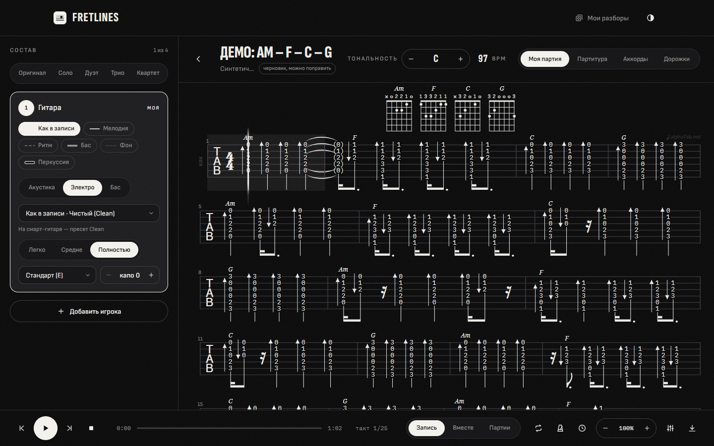
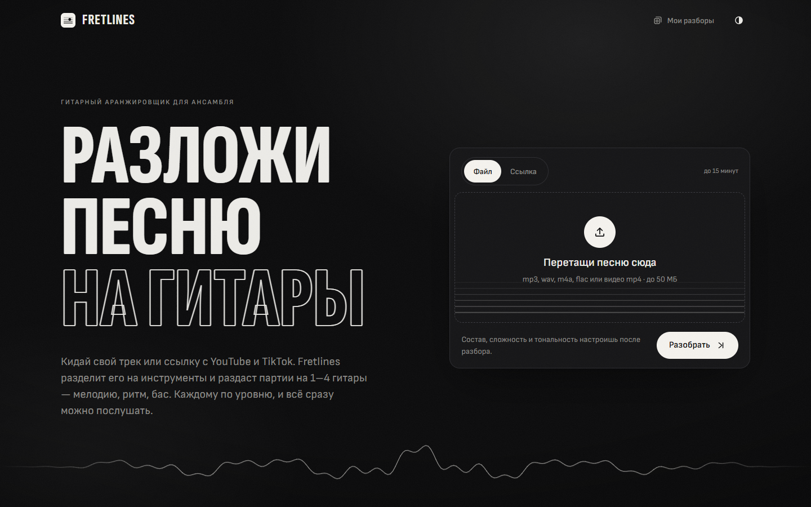

# Fretlines

**English** · [Русский](README.ru.md)

A guitar arranger for small bands. Give it a song (an audio or video file, or a YouTube or
TikTok link) and it writes parts for 1–4 guitars: melody, rhythm, bass and fingerpicking. Each
player gets a part at their own level, with tabs, chord diagrams and a player that plays the
parts with a guitar sound.



Everything runs on your own computer: songs and analyses never leave it.

> **Status:** an early personal project. The interface is in Russian only. The launcher is
> Windows-first (`start.bat`); on Linux, use GitHub Codespaces or the Dockerfile. Automatic
> transcription is a draft: chords and rhythm usually come out well, the melody depends on how
> clearly the vocal can be heard.

## How it works

1. **Get the audio.** An uploaded file (mp3, wav, m4a, flac, mp4 video and more), or a YouTube,
   TikTok or SoundCloud link downloaded with yt-dlp.
2. **Split it into stems.** MDX-Net Inst HQ4 separates the vocal (BS-RoFormer on a GPU), then
   Demucs splits the instrumental into guitar, bass, drums, keys and the rest.
3. **Listen.** Beat This! finds beats and bars. Chords come from two chromagrams, CQT and
   Basic Pitch note probabilities (which have almost no overtones), with chord changes more
   likely on strong beats. CREPE gives the melody and bass notes. Whisper times every word of
   the lyrics, and a ready-made text is looked up on lrclib.net. PANNs listens to the guitar
   stem and the whole mix to guess the guitar tone and genre.
4. **Arrange.** A pure-Python engine maps the parts onto the fretboard with dynamic
   programming that keeps hand movement to a minimum (a stretch of at most 4 frets, 3 on
   "easy"). It builds chord voicings for any tuning and capo, strums on the drums' accents and
   writes fingerpicking, percussion and fingerstyle parts.
5. **Play.** The studio renders the parts with alphaTab and plays them in time with the
   original recording.

## Features

- **"As recorded" part:** the guitar notes from the original (Basic Pitch on the guitar stem)
  are laid onto the chord shapes the guitarist holds, at the neck position where the recording
  sounds. Strums are played as whole chords, picking follows the strings of the shape, and
  riffs and solos are played note for note.
- **Band setup:** 1–4 players with Solo / Duo / Trio / Quartet presets. Each player has their
  own instrument (acoustic, electric or bass guitar), tuning, capo and difficulty (easy, medium
  or full).
- **Studio sound:** every part is rendered through its own signal chain. The electric guitar
  has 11 tones (clean, funk, chorus, ambient, jazz, blues, crunch, drive, fuzz, lead and
  metal), and the tone can be picked automatically to match the recording.
- **Recording in sync with the tabs:** the player plays the song itself while the tab cursor
  follows it, bar by bar. Any stem can be muted: drop the guitar to play over the track, or the
  vocal to sing yourself.
- **Stems:** each stem and the instrumental can be played on its own and downloaded as 24-bit
  FLAC or MP3, or all at once as one archive.
- **Lyrics:** a karaoke line under the tabs, a lyrics view with chords above the words, and
  words right under the notes.
- **Key and capo:** transpose ±12 semitones and get a hint for the best capo (fewer barre
  chords). Changes are recalculated in under a second, without re-running the analysis.
- **Practice tools:** A–B loop, metronome, count-in, tempo 50–120 %, and a mixer with mute,
  solo and volume.
- **Export:** PDF (print), Guitar Pro (.gp), MIDI and alphaTex.



## Getting started

### Windows

Double-click **`start.bat`**. The browser opens by itself at http://127.0.0.1:8080.

The first start takes longer: uv, Python 3.11 and the libraries are installed into the
project's `.tools/` folder, and the interface is built. Building the interface needs
[Node.js](https://nodejs.org) 20 or newer. After that the app starts in a couple of seconds.

The analysis models are downloaded into `.models/` on the first analysis: Demucs, Beat This!,
CREPE and Basic Pitch (about 130 MB), MDX-Net for the vocal (60 MB), PANNs for the guitar tone
(25 MB) and Whisper small for the lyrics (about 460 MB). To download everything in advance:
`.venv\Scripts\python scripts\fetch_models.py`.

On a CPU, the best-quality analysis takes about 2–3 times the length of the song. With an NVIDIA
GPU it is roughly 5–10 times faster: run **`gpu.bat`** once to install PyTorch with CUDA (about
2.5 GB). `gpu.bat off` switches back to the CPU build.

To open the app from your bandmates' phones on the same Wi-Fi, start it with
`start.bat --host 0.0.0.0` and go to `http://<computer-ip>:8080`.

### GitHub Codespaces

On the repository page, click **Code → Codespaces → Create codespace on main**. The first start
takes 5–10 minutes while the libraries install, the interface builds and the models download.
After that the app starts by itself every time the codespace starts. Open it from the
**Ports → Fretlines** tab. See [.devcontainer/README.md](.devcontainer/README.md) for details.

The [Dockerfile](Dockerfile) works for any container host.

## Development

All tools are installed inside the project; uv lives in `.tools/uv/uv.exe`. In PowerShell,
load the environment variables once with `. .\scripts\common.ps1`.

```bash
.tools/uv/uv.exe sync                       # environment with dev tools
.tools/uv/uv.exe run pytest                 # fast tests: arranger, backend, worker
.tools/uv/uv.exe run pytest -m slow         # full analysis of a synthetic song with the models
.tools/uv/uv.exe run ruff check .
.tools/uv/uv.exe run mypy                   # strict
.tools/uv/uv.exe run python -m fretlines_api --no-browser
```

The interface dev server runs at http://localhost:5173 and proxies `/api` to :8080:

```bash
cd frontend
npm install
npm run dev
npm run lint && npm run typecheck && npm run build
```

```text
fretlines/
├── start.bat, gpu.bat   launch and GPU switch
├── backend/             FastAPI: API, analysis queue (one process per song), serves the interface
├── worker/              analysis: yt-dlp, ffmpeg, stem separation, beats, chords, notes, lyrics
├── arranger/            pure-Python arranging engine: fretboard, voicings, parts, alphaTex
├── frontend/            React + TypeScript + Vite + Tailwind + alphaTab
├── storage/             songs, stems, analyses and the SQLite database (not in git)
├── .tools/              uv, Python and the library cache (installed automatically)
└── .models/             model weights (downloaded automatically)
```

Settings live in a `.env` file or environment variables; see [.env.example](.env.example).

| Variable | Default | What it does |
|---|---|---|
| `FRETLINES_HOST` | `127.0.0.1` | `0.0.0.0` opens the app to the local network |
| `FRETLINES_PORT` | `8080` | port; if it is taken, the next free one is used |
| `FRETLINES_DEVICE` | `auto` | `cpu` always uses the CPU, `cuda` the GPU |
| `FRETLINES_STORAGE_DIR` | `storage` | where songs and analyses are stored |
| `FRETLINES_MAX_UPLOAD_MB` | `50` | audio upload limit (200 MB for video) |
| `FRETLINES_SEPARATION` | `max` | `standard` separates with Demucs alone, about twice as fast |
| `FRETLINES_LYRICS` | `online` | `local` recognises lyrics only, without the network; `off` disables lyrics |
| `FRETLINES_LYRICS_MODEL` | `small` | Whisper model: `medium` or `large-v3` are more accurate but slower |

## Privacy and rights

Analyses are stored only on your computer; there is no public catalogue. Audio is never sent
anywhere. To look up lyrics on lrclib.net, only the title, artist and duration are sent; turn
this off with `FRETLINES_LYRICS=local`. Downloading by link is meant for personal practice:
don't publish other people's music, and respect the rights of the authors and the rules of the
platforms.

## License

Fretlines is released under the [MIT License](LICENSE).

Third-party components keep their own licenses. The MuseScore General sound bank is MIT
(S. Christian Collins, based on FluidR3Mono and FluidR3 © Frank Wen). Basic Pitch is
Apache-2.0 (Spotify). Whisper is MIT (OpenAI), and so is faster-whisper. audio-separator is MIT;
the MDX-Net and RoFormer models come from the Ultimate Vocal Remover project (Anjok07, aufr33,
ViperX). PANNs code is MIT and its weights are CC BY 4.0 (Kong et al., 2020). Song lyrics
belong to their authors.
